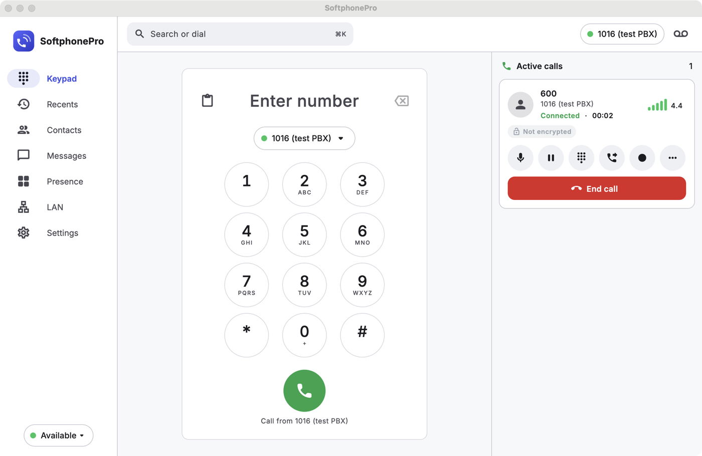
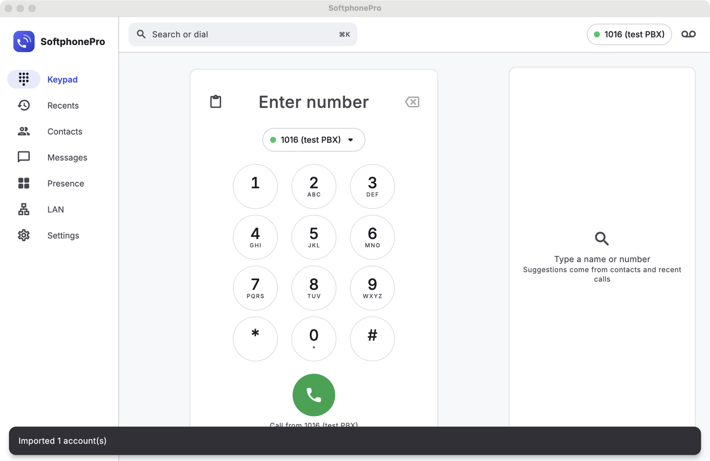
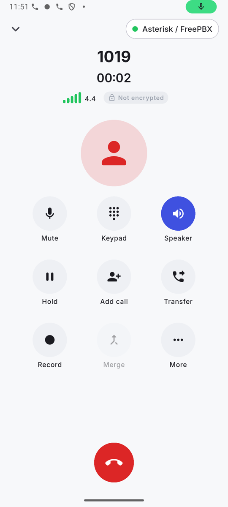
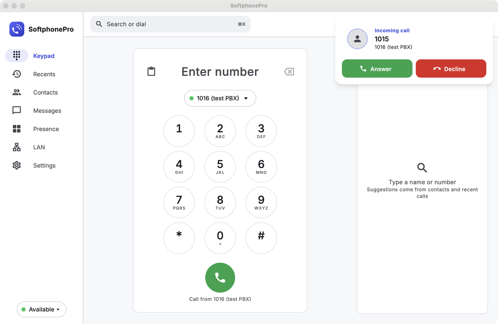
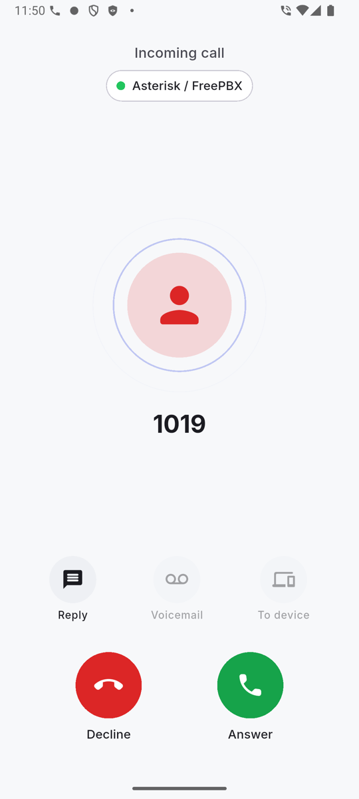
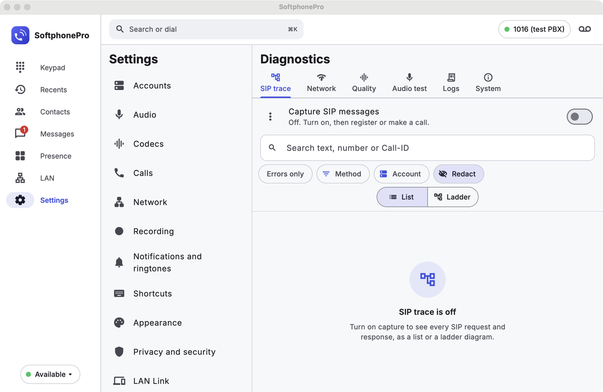
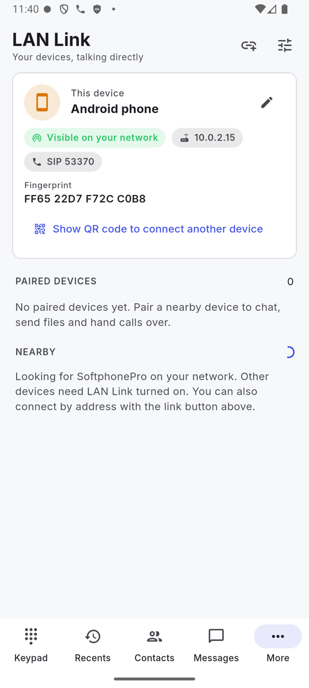
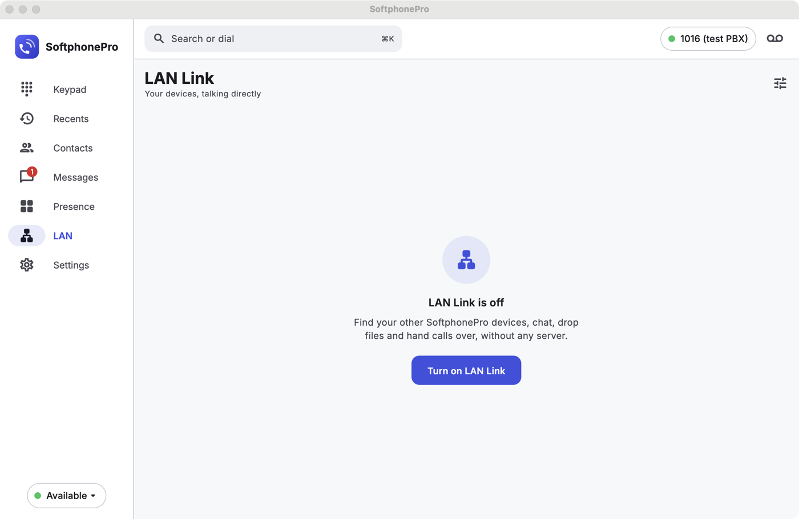

<div align="center">


# SoftphonePro

**A free, open-source softphone for Windows, macOS, Linux, Android and iOS, with many of the features of paid apps like Zoiper Premium and Bria.**

Run as many SIP/IAX2 accounts as you need at the same time · Encrypted calls · Hand calls to other devices on your network · No ads, no tracking, no subscription

[](https://github.com/cyberkyd01/SoftphonePro/actions/workflows/ci.yml)
[](LICENSE)
[](https://github.com/cyberkyd01/SoftphonePro/releases)

[**Download**](#download) · [Features](#features) · [Screenshots](#screenshots) · [Getting started](#getting-started) · [Build from source](docs/BUILDING.md)

</div>

---

<p align="center">
  
</p>

## Download

Get the latest builds from the [**Releases page**](https://github.com/cyberkyd01/SoftphonePro/releases/latest).

| Platform | File | Notes |
|---|---|---|
| **Windows** 10/11 (x64) | `SoftphonePro-Setup-<ver>-x64.exe` (installer) or `SoftphonePro-<ver>-windows-x64-portable.zip` | The installer registers `sip:`, `sips:`, `tel:`, `callto:` and `softphonepro:` links. The build isn't code-signed yet, so if SmartScreen appears choose **More info → Run anyway**. |
| **macOS** 11+ (Apple Silicon and Intel) | `SoftphonePro-<ver>-macOS.dmg` | Drag the app to Applications. The build isn't notarised, so open it the first time with **right-click → Open**, or run `xattr -dr com.apple.quarantine /Applications/SoftphonePro.app`. |
| **Linux** (Ubuntu 22.04+, Debian 12+, Raspberry Pi OS 64-bit Bookworm) on PCs (amd64) | `SoftphonePro-<ver>-linux-amd64.deb` or `SoftphonePro-<ver>-linux-amd64.tar.gz` | Install the `.deb` with `sudo apt install ./SoftphonePro-<ver>-linux-amd64.deb`, or open it in your software centre. The tarball runs in place with `./softphonepro`. See [Install on Linux / Raspberry Pi](docs/USER_GUIDE.md#install-on-linux--raspberry-pi). |
| **Linux** on ARM (arm64): Raspberry Pi 4/5 (also Pi 3) with 64-bit Raspberry Pi OS, ARM Ubuntu and Debian | `SoftphonePro-<ver>-linux-arm64.deb` or `SoftphonePro-<ver>-linux-arm64.tar.gz` | Same steps as above. 32-bit Raspberry Pi OS is not supported. |
| **Android** 7+ | `SoftphonePro-<ver>-android-universal.apk` (or a per-ABI `…-android-<abi>.apk`) | Allow "Install unknown apps" for your browser or file manager. |
| **iOS** 15.5+ | `SoftphonePro-<ver>-unsigned.ipa` | Install it with AltStore or Sideloadly. The App Store doesn't allow GPL apps. |
| **Browser** (Chrome, Edge, Brave, Firefox) | `SoftphonePro-ClickToDial-*.zip` | Click any phone number on a web page to call it with SoftphonePro. See [extensions/browser](extensions/browser/README.md). |

## Features

**Accounts**
* Up to **64 accounts registered at once**.
* SIP over **UDP, TCP, TLS 1.2/1.3 and WebSocket (WS/WSS)**, plus **IAX2**.
* **Automatic transport:** pick *Automatic (DNS SRV)* and the app chooses TLS, TCP or UDP from the server's DNS records, and shows the server it resolved.
* **Mutual TLS:** a client certificate and key per account, for servers that require one.
* Each account has its own codecs, transport, NAT options, DTMF mode, caller ID, ringtone and hold music.
* Ready-made templates for Asterisk/FreePBX, 3CX, FreeSWITCH, Kamailio, Twilio, Telnyx, VoIP.ms, Vonage, WebRTC gateways and IAX2.
* Automatic failover to a backup server.
* Retries back off sensibly. Registration stops after a wrong password, so your provider won't lock you out.
* Set accounts up from a link (`softphonepro://provision?url=…`), a QR code or a file, or by entering details manually.

**Calls**
* HD audio: Opus, G.722, G.711, G.729, GSM, iLBC, Speex, G.722.1 and L16.
* **Voice isolation:** AI noise cancellation (RNNoise) that runs on your device. It cleans up your microphone and, separately, the incoming audio from noisy callers, with adjustable strength and a live speech meter.
* Echo cancellation (WebRTC AEC3 where available, otherwise Speex), noise suppression and a jitter buffer you can tune.
* Hold, mute, call waiting and swap.
* **Musicbed:** loop an MP3 or WAV file under your voice to everyone on your calls, with its own volume (0-200%) and an optional "Hear it myself" monitor. It keeps playing while you are muted.
* **Audio test:** a guided check of your devices, microphone level, speaker, a record-and-play-back, "hear yourself" and the background music (including a preview of what callers hear), with a summary you can copy for support. Settings > Audio > Test microphone and speakers.
* **Live audio mixer:** level bars and sliders for your microphone, speaker and musicbed, with input and output device pickers, on the keypad screen, during calls and in Settings > Audio.
* **Hold music** from a built-in track or your own file, and **announcements**: a message played when a call connects, a notice before recording starts, and a notice played to the caller before a transfer.
* An **audio library** for those files: import WAV or MP3, or record your own.
* **Blind and attended transfer**, and a **local N-way conference** with per-person volume.
* **Caller identity:** the name and number the network asserts (`P-Asserted-Identity`, `Remote-Party-ID`), plus "Forwarded from" and "Transferred by".
* DTMF as RFC 2833, SIP INFO or in-band.
* **Call recording** as WAV, stereo WAV (you left, caller right) or compressed Ogg Opus. Record automatically by rule (all, incoming, outgoing, per account, per contact), keep recording through transfers, and manage everything in a **Recordings page** with search, playback, export and auto-delete.
* Auto-answer and intercom (`Call-Info`, `Alert-Info` and `Answer-Mode` headers).
* Do-not-disturb and call forwarding: always, when busy, or when unanswered. These can also be synced to the PBX through feature codes.
* Call park and retrieve, and group/directed pickup, including BLF pickup with Replaces.
* Speed dial, dial plans and E.164 number rewriting, anonymous-call rejection and a blocklist.
* Direct IP calls without any server.

**Security**
* TLS with certificate verification, using a bundled Mozilla CA list. You can trust a server's certificate by pinning it, with no extra setup.
* **SRTP** (SDES, AES-CM/GCM) and **DTLS-SRTP**.
* A padlock on every call shows whether the call is encrypted.
* Passwords live in the OS keystore, with an encrypted-file fallback.
* Optional **encryption of the local database** (call history, contacts, messages, settings) with AES-256-GCM. The key stays in the OS keystore.
* App lock with a PIN or biometrics. Incoming calls still ring while the app is locked.
* No analytics or telemetry.

**Messaging, presence and BLF**
* SIP instant messages with delivery receipts and typing indicators.
* Presence, a **Busy Lamp Field** board, and voicemail (MWI) badges with one-tap voicemail.

**LAN Link: features other apps don't have.** SoftphonePro devices on the same network can:
* **Find each other automatically** (mDNS/Bonjour, plus multicast beacons, which are all Linux uses).
* **Pair securely** after you compare a 6-digit code on both screens. The link is end-to-end encrypted (X25519 + AES-256-GCM).
* **Hand off any external call to another device**, blind or after talking first. If the other device can be reached through your PBX, a SIP REFER is used. Otherwise the call is relayed through the device that holds it.
* **Pull a call** that's active on another device to your own.
* Make **direct LAN calls and intercom** with no server needed.
* **Chat and drop files** between devices. Each file needs your OK before it's received, and its integrity is checked with SHA-256.

**Diagnostics**
* A live call-quality panel showing MOS, jitter, packet loss and round-trip time, with charts. The quality summary is saved for every call.
* A built-in **SIP trace viewer** with a ladder diagram and raw messages. Traces export as `.log` or `.pcap`, with passwords removed.
* A **network diagnostics wizard**: NAT type, DNS/SRV lookups, SIP OPTIONS ping, TLS certificate check and SIP-ALG detection.
* Audio tests, a log viewer, and a support bundle you can export.

**Integrations**
* **Local automation API** (Windows, macOS and Linux; off by default): place and control calls, receive call events and send messages from a CRM, helpdesk or script, over HTTP on `127.0.0.1` with a token. It's the free counterpart of Bria's paid Desktop API. See [docs/AUTOMATION_API.md](docs/AUTOMATION_API.md).
* **Browser extension** for Chrome, Edge, Brave and Firefox: click any phone number on a web page to call it with SoftphonePro. See [extensions/browser](extensions/browser/README.md).
* `sip:`, `sips:`, `tel:`, `callto:` and `softphonepro:` links, and `--dial` / `--provision` on the desktop command line.

**Platform integration**
* **Windows/macOS/Linux:**
  * a tray or menu-bar icon;
  * notifications with Answer/Decline;
  * global hotkeys;
  * start at login;
  * one running instance;
  * the option to make SoftphonePro your default app for `sip:`/`tel:` links;
  * the headset or media play/pause key answers and hangs up calls;
  * an update checker (opt-out) that tells you when a new release is on GitHub.
  * On Linux the tray icon needs a desktop with a StatusNotifierItem host, and global hotkeys work on X11 sessions only (see the [user guide](docs/USER_GUIDE.md#10-platform-notes)).
* **Linux:** also media-key support through MPRIS, `sip:`/`tel:` link handling through `xdg-mime`, and passwords in the Secret Service keyring (GNOME Keyring or KWallet).
* **Android:**
  * a foreground service keeps your accounts registered;
  * full-screen incoming calls;
  * system call integration through Telecom;
  * Bluetooth, wired-headset and earpiece routing;
  * proximity sensor.
* **iOS:** CallKit integration.
* **Every platform:**
  * T9 search in the dialer;
  * light and dark themes with an adaptive layout for phones, tablets and desktops.
* **13 languages:** English, Español, Français, Deutsch, Português (Brasil), Italiano, Nederlands, Русский, Türkçe, हिन्दी, العربية (right-to-left), 简体中文 and 日本語. The language follows the system by default and can be changed in Settings > Appearance > Language. Log and trace contents, SIP tokens and codec names stay in English.
* **Phones and Mac:** import contacts from the device, and scan QR codes with the camera (Windows and Linux can paste the code).

The full list of about 115 features, each with its status and the test that backs it, is in [docs/FEATURES.md](docs/FEATURES.md). Some features are only partly tested (marked ◐ there); read [Known limitations](#known-limitations) before you rely on them.

## Screenshots

| macOS | Android |
|---|---|
|  |  |
|  |  |
|  |  |
|  |  |

## Getting started

1. **Install** the app for your platform (see [Download](#download)).
2. **Add an account.** Open the app and choose **Get started → Add account**. Pick your provider's template, or choose *Generic SIP* and enter your username, password and domain. Your administrator can also send you a provisioning link or QR code that sets everything up in one tap.
3. **Make a call** from the keypad, recent calls, contacts, or any `sip:`/`tel:` link.

**More guides:**
* [User guide](docs/USER_GUIDE.md): provisioning format, LAN Link, transfers, recording, audio and troubleshooting.
* [Release notes for v1.1.2](docs/RELEASE_NOTES_v1.1.2.md) and the [changelog](CHANGELOG.md).
* [Automation API](docs/AUTOMATION_API.md): control SoftphonePro from your CRM or scripts.

## How it's built

* **One UI for all five platforms**, written in Flutter and compiled to native code.
* **One calling engine** written in C (`spcore`, built on [PJSIP 2.17](https://www.pjsip.org/)). Flutter talks to it through a small JSON API (FFI).
* **Thin native layers** for the rest: Kotlin for Android (foreground service, Telecom), Swift for iOS (CallKit) and macOS, and C++ for Windows, and a GTK runner for Linux.

Details are in [docs/ARCHITECTURE.md](docs/ARCHITECTURE.md) and the engine contract is in [docs/ENGINE_API.md](docs/ENGINE_API.md).

```
app/                    Flutter application (UI, controllers, platform layers)
native/                 C engine "spcore" + dependency build scripts + engine tests
packages/spcore_dart    Dart API for the engine (FFI) + simulator
packages/spcore_flutter Flutter plugin that bundles the native engine
packages/lan_link       LAN discovery, pairing, encrypted link, chat, files, handoff
extensions/browser      Click-to-dial browser extension
tests/sipserver         Asterisk test PBX (Docker) used by the integration tests
```

## Quality and testing

Every push goes through CI on GitHub Actions:
* builds for Windows, macOS, Linux (amd64 and arm64), iOS and Android;
* the engine test suite (over 200 tests) against a real Asterisk PBX: SIP, IAX2, WS/WSS, SRTP, transfers, conferences, BLF, MWI, recording, voice isolation, mutual TLS and more;
* Dart tests of the engine API (over 60) and of the LAN Link protocol (over 50, including fuzzing and stress tests);
* over 360 Flutter unit and widget tests, including golden-image tests;
* over 60 tests of the browser extension.

The engine suite has also been run locally under ASan/UBSan (see [docs/reviews](docs/reviews)); that run is not part of CI.

Device testing is narrower than the automated tests. On earlier builds of this release the Linux app (arm64 Debian 12 and Ubuntu 24.04 containers with fake tray, notification and Secret Service hosts, plus a real gnome-keyring), the Android app (emulator) and the macOS app were exercised end to end ([docs/QA_LINUX.md](docs/QA_LINUX.md), [docs/QA_ANDROID.md](docs/QA_ANDROID.md), [docs/QA_MACOS.md](docs/QA_MACOS.md)); the Linux packages are also installed and smoke-tested in CI on both architectures. The engine's audio (live meter, echo test, device switching and recovery, test chime) was tested on Windows 11 hardware with a known tone through a virtual audio cable. **Not tested:** Raspberry Pi hardware, Wayland, real GNOME/KDE tray hosts, the Windows app's screens and iOS on a device (CI builds and launch smoke only; macOS calls on this build likewise). Independent reviews of the engine and of the features are in [docs/reviews](docs/reviews).

## Known limitations

* **iOS background calls:** iOS only gets incoming calls while the app is running. Background calls would need VoIP push notifications (PushKit) plus a push server, and the PBX has to support it. Android keeps accounts registered in the background with a foreground service instead.
* **Not yet supported:** video calls and ZRTP. These are planned for a later version.
* **Translations** are machine-assisted, so some wording may sound unnatural. Corrections are welcome in `app/lib/l10n/`.
* **Recording files** are not encrypted, even when the database is.
* **Unsigned builds:** builds aren't code-signed or notarised yet, so expect a one-time security prompt on Windows and macOS, and sideloading on iOS.
* **Linux:**
  * Supported on 64-bit systems only (Ubuntu 22.04+, Debian 12+, Raspberry Pi OS Bookworm 64-bit). 32-bit Raspberry Pi OS is not supported, because Flutter has no 32-bit ARM Linux build.
  * There is no QR camera scanning (paste the code), no biometric app unlock (PIN only), no mDNS discovery (LAN Link uses its multicast discovery, which still finds the other platforms) and no system contacts import.
  * The tray icon needs a StatusNotifierItem host (stock GNOME needs the AppIndicator extension); without one, closing the window quits. Global shortcuts work on X11, not Wayland.
* **Musicbed**: calls on hold hear the hold music instead of it. The local automation API can switch it on and off and set its volume (`/v1/audio`), but the file is chosen in the app only.
* **Hold music through Asterisk:** when the PBX answers a hold request itself, the caller hears the PBX's own music, not yours. Your music plays on direct calls and on PBXs that relay the held party's audio.
* **Ogg Opus recordings** play inside the app on Android and Linux only. On iPhone, Mac and Windows use *Open with…* or export the file.
* **Partly tested areas:** see the ◐ rows in [docs/FEATURES.md](docs/FEATURES.md), for example STUN/TURN against real servers, IPv6, session timers, 100rel, SIP Outbound, camera QR scanning, device contacts, CallKit and the Android Telecom integration.

## Contributing

Bug reports and pull requests are welcome.
* Read [docs/BUILDING.md](docs/BUILDING.md) first.
* Run the tests: `flutter test` in `app/`, and `python3 native/tests/run_tests.py` with the test PBX from [tests/sipserver](tests/sipserver/README.md).
* Keep the engine contract ([docs/ENGINE_API.md](docs/ENGINE_API.md)) up to date when you change it.

## License

SoftphonePro is free software under the **GNU General Public License v3.0 or later**. See [LICENSE](LICENSE).

It's built on these open-source components. The complete list, with versions and source links, is in [THIRD_PARTY_NOTICES.md](THIRD_PARTY_NOTICES.md).

| Component | License |
|---|---|
| PJSIP 2.17 (with the libraries it bundles) | GPLv2+ and permissive licences |
| OpenSSL 3.5 | Apache-2.0 |
| Opus 1.6 | BSD-3-Clause |
| bcg729 (G.729) | GPLv3 |
| RNNoise 0.1.1 (voice isolation) | BSD-3-Clause |
| minimp3 (MP3 decoding) | CC0 |
| cJSON | MIT |
| Flutter and Dart packages | BSD-3-Clause, MIT, Apache-2.0 |
| Inter font | OFL-1.1 |
| Mozilla CA bundle | MPL-2.0 |

The in-app **Settings → About** page lists these notices, and its licence page lists the Flutter and Dart packages.

---

## ⭐ Support

Please give stars and if possible Buy me a coffee (USDT-TRC20) - `TA216k3WgWTrKnUKxZrSDNGzSJj3eHtEcH`

Telegram: [@Cyberkyd](https://t.me/Cyberkyd)
