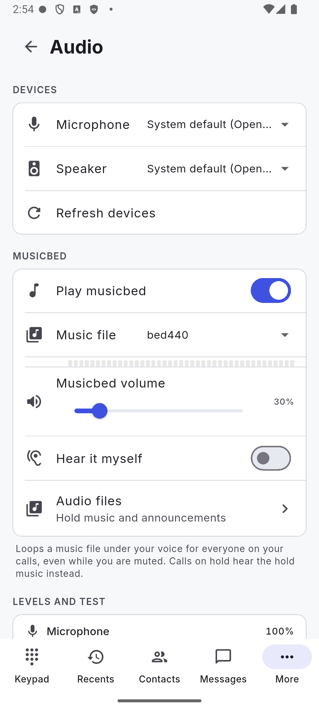
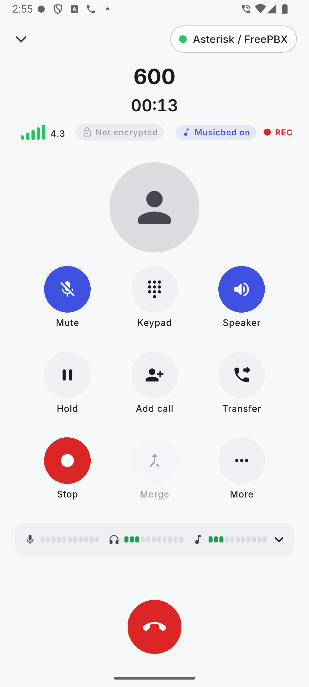
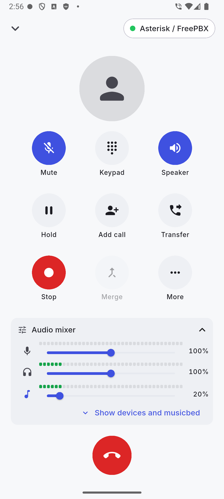
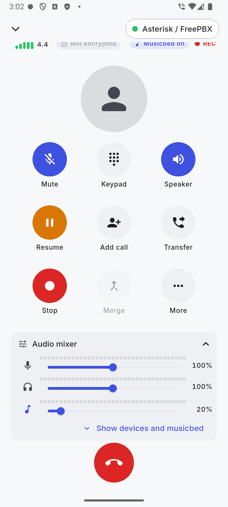
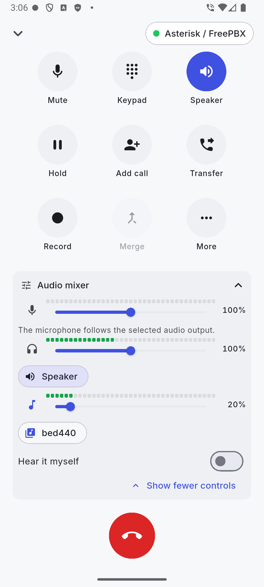
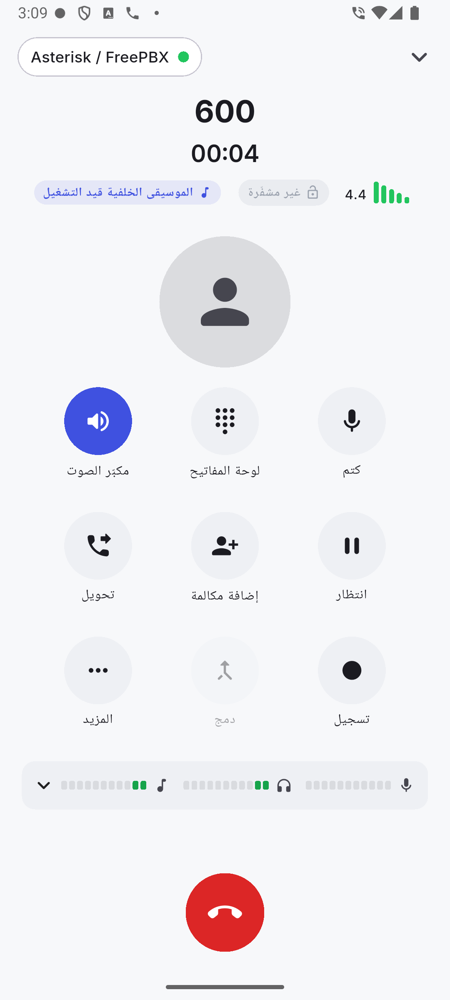

# Android device QA

Date: 2026-10-19. Build: `flutter build apk --release --target-platform android-arm64`
(Flutter 3.32.1, app version from pubspec), installed on emulator-5554 (arm64, Android 15) with the
real `libspcore` engine. Far end: Asterisk test PBX (tests/sipserver, reached as 10.0.2.2) and the host
`spcore_cli`. Screenshots: `docs/qa-screenshots/` (names below).

Release-build gotcha: after editing Dart, an incremental `flutter build apk --release` once re-used a stale
AOT snapshot (a 4 s build that ignored the changes). Delete `app/build/app/intermediates/flutter` before
building when a change does not show up.

## Environment limits (not app bugs)

The PBX container was started with `PBX_EXTERNAL_ADDR=127.0.0.1` (not `up.sh --emulator`) and must not be
restarted for this run, so:

* Asterisk puts `127.0.0.1` in its SDP and Contact. The emulator therefore sends no RTP to the PBX
  (nothing arrives at Asterisk; `rtp set debug` confirmed zero inbound packets) and DTMF/echo audio cannot be
  verified through the PBX.
* On calls Asterisk originates (incoming to the app), its Contact is the container address 172.18.0.2, so
  in-dialog requests from the app (BYE, REFER) do not reach Asterisk. The app's own BYE to the far end was never
  seen by the host CLI. BYE from Asterisk to the app does arrive.
* Asterisk keeps stale 1020 contacts after force-stop / airplane mode (new source port each time) and rings
  the stale one first, so incoming calls fail for up to a few minutes after a re-registration with a new port.
  This is registrar behaviour, not an app fault; calls worked again once the stale contacts expired.
* pjsip switches to TCP for INVITEs larger than the MTU. A far-end CLI with TCP disabled never sees them.

To make the PBX-dependent cases (D, F via the PBX, media) fully verifiable, restart the PBX with
`tests/sipserver/scripts/up.sh --emulator`.

## Results

| Case | Result | Notes / screenshots |
|---|---|---|
| A. Fresh install, provisioning by deep link (cold and warm), account 1020 registers | PASS | Cold: confirm dialog over onboarding (`A1_cold_dialog`), Import finishes onboarding, green chip (`A1_after_import`); `pjsip show contacts` lists `1020`. Warm: dialog appears, no "Page Not Found" (`A2_warm_dialog`). Both were broken before the fixes below. |
| B. Outgoing call to 600 from the keypad | PASS | In-call screen, timer, quality 4.4 (`B1_incall`), hang up gives a history row (`B2_recents`). |
| C. Incoming 1019 to 1020: foreground, background / screen off, answer, hang up from each side, missed call | PASS (with env note) | In-app incoming page plus heads-up (`C1_incoming_fg`), answered (`C2_answered`), screen-off full-screen incoming (`C3_locked_incoming`), missed-call notification (`C4_missed_notification`), remote hangup ends the app call and returns to Recents (`C5_after_remote_hangup`); history rows for incoming, missed. App-side hangup ends the app call and writes history, but the BYE does not reach the host CLI (environment limit above). |
| D. DTMF 1234 | PASS (direct call), BLOCKED via PBX 602 | Through 602 the PBX read nothing (no inbound RTP, see limits). The in-call keypad shows `1234` (`D2_typed`). Against a host CLI called directly (`sip:far@10.0.2.2:5090`) the far end logged RFC 2833 digits 1, 2, 3, 4 (`D5_dtmf_far`). |
| E. Hold/unhold, mute | PASS | "On hold" label, orange Resume button, mute state; no crash (`E1_mute_hold`, `E2_unmuted`). |
| F. Blind transfer from an incoming call to 600 | BLOCKED | REFER cannot reach Asterisk (limit above). The transfer sheet works; found and fixed the keyboard-covered sheet (below; `F1_transfer_ui`, `F6_transfer_kb_fixed`). Re-test after a PBX restart in emulator mode. |
| G. Settings: codec order, DND, dial rules, themes | PASS | Codec reorder persisted (`G2e_after_drag`); DND rejects with 486, history "Declined" (`G4_dnd`, `K4_recents`); dial-rule live test cleans `+1 (555) 010-2030` to `+15550102030` (`G11_dialrules`); dark theme (`G7`..`G10`), light theme in the A to E shots. Codec list had a visual gap (fixed, below; `G2c` before, `G2d_codecs_fixed` after). |
| H. App lock | PASS | PIN set (`H2_setpin`), lock after "Immediately" locks on return (`H4_lockscreen`), incoming call over the lock screen is shown and answerable (`H6`, `H7`), lock returns after the call (`H8`), unlock and turn off with PIN (`H9`, `H10b`). Note: with "Lock after: 1 minute" a 70 s background did not lock once (not reproduced; unit logic in `app_lock_controller.dart` looks right). Worth one more manual run. |
| I. Diagnostics | PASS | SIP trace list with INVITE/100/180/200/ACK/BYE (`I2_trace_list`), ladder (`I3_ladder`, `I4_ladder_detail`), network wizard 5 pass / 1 warn (STUN did not answer in the emulator) (`I5_network`, `I6_network_results`). |
| J. tel:/sip: links | PASS | `tel:600` with "call links immediately" on starts the call (`J1_tel_immediate`). With it off the dialer is prefilled; before the fix the app stayed on whatever page was open (`J2_tel_prefill`), now it opens the keypad. The system chooser lists SoftphonePro next to Phone. |
| K. Engine resilience | PASS | Force-stop during a call then relaunch re-registers within seconds (`K1_after_forcestop`); airplane mode on/off re-registers in 7 s (new contact seen on the PBX) (`K3_after_airplane`). The call that was interrupted by force-stop is not written to history. |

## Bugs fixed

1. Warm-start deep link showed "Page Not Found": Flutter's own deep-link handling forwarded
   `softphonepro://...` to go_router. `AndroidManifest.xml` now sets `flutter_deeplinking_enabled=false`;
   `macos/Runner/Info.plist` sets `FlutterDeepLinkingEnabled=false` (iOS already did; the Windows runner has no
   built-in deep-link routing).
2. Cold-start provisioning link never showed the confirm dialog: `link_handler.dart` read the root navigator
   context before the router had mounted. It now waits (up to 20 s) for the navigator overlay. Test:
   `test/polish_a1_test.dart` "cold-start provision link during onboarding shows the confirm dialog and
   finishes onboarding".
3. Codecs screen showed a tall blank gap and duplicate list keys: the engine reports some codecs several times
   (G7221 variants share an id). `orderCodecs` / `codecListProvider` in `lib/ui/settings/sections.dart` now
   de-duplicate. Test: `test/codec_order_test.dart`.
4. Transfer sheet was hidden behind the keyboard: it used the call page's `MediaQuery` (inset already consumed by
   the Scaffold). `showTransferSheet` in `lib/ui/widgets/call_widgets.dart` now uses the sheet's own context.
   Test: `test/transfer_keyboard_test.dart` (fails without the fix).
5. `tel:` / `sip:` links with "call links immediately" off only filled the dial field without showing it when
   another page was open. `link_handler.dart` now opens `/keypad` (not during onboarding or a call). Test:
   `test/polish_a1_test.dart` "tel: link shows the dialer prefilled even from another page".

## Remaining issues / observations

* Blind transfer (F) and PBX DTMF (D) need the PBX in emulator mode to be confirmed end to end.
* After a blind transfer whose REFER gets no answer, the call stays up with no "transferring" feedback.
* In-call keypad panel: the bottom button row is clipped behind the End button until scrolled; the on-screen
  keyboard squeezes the call page (labels disappear) while the transfer field is focused.
* Network wizard shows the raw engine string "ErrUnknown" for the STUN failure detail.
* Transfer sheet: the "LAN device" segment label wraps to two lines at 411 dp width.
* Dial rules page uses a smaller, differently aligned header than the other settings pages.
* While the app is foreground, an incoming call shows both the in-app page and a heads-up notification.
* Speaker is on by default for calls on the emulator (no earpiece route reported).
* History labels a DND-rejected call "Declined" (the call model result is `rejected`/declined).

## Follow-up fixes (UX2 polish pass)

Fixed in the app, with tests in `app/test/recordings/qa_leftovers_test.dart`. Not yet re-checked on the emulator.

* Blind transfer with no REFER answer: "Transferring..." is shown, and after 10 s "Transfer not confirmed by the server" offers **Keep call** and **Retry**.
* In-call keypad: it replaces the action grid while open, so its bottom row is never behind the End button (**Hide keypad** closes it).
* Transfer sheet: the segment is labelled "LAN" (tooltip "LAN device") and stays on one line.
* Network wizard: the raw "ErrUnknown" is shown as "The STUN server did not answer, so the NAT type could not be determined."
* Dial rules page: same large header (with back and add) as the other settings pages.
* Incoming call in the foreground (Android, app resumed): only the in-app page is shown; the heads-up notification is posted only when the app is in the background or locked.
* A call interrupted by force-stop: an "active calls journal" is written when a call starts and answers (with a heartbeat), and leftovers of an earlier run become "Interrupted" history entries at the next start.

## v1.0.0 final

Date: 2026-10-19. Build: `flutter build apk --release --target-platform android-arm64` of main `9eb7cb7` (activity-recreation fix included); cases K and L ran on a rebuild of the same commit plus the working-tree Back-button fix below (uncommitted). Emulator-5554 (arm64, Android 15), real `libspcore`. PBX in emulator mode (`up.sh --emulator`, advertises 10.0.2.2), account 1020. Provisioning was by deep link `softphonepro://provision?url=http://127.0.0.1:18765/cfg.json` (http is only accepted for localhost, so `adb reverse tcp:18765`). Screenshots: `docs/qa-screenshots/v100final_android_*.png`.

| Case | Result | Evidence |
|---|---|---|
| A. Provisioning via deep link, 1020 registers | PASS | Confirm dialog (1 account, "Dials custom PBX feature codes" warning), Import; keypad shows "Calling from 1020", PBX `pjsip show contacts` lists `1020`. |
| B. Outgoing call to 600, real audio path | PASS | PBX `Echo()` channel up. PBX `pjsip show channelstats` after 32 s: receive 1608, transmit 1606, lost 0 (RTP flows both ways). App quality sheet: PCMU, MOS 4.33, jitter 2.1 ms, loss 0 %, RTT 158 ms (`b2`). The in-call panel has no rx packet counter (only history `Rx/Tx pkts` widget exists in code), so packet evidence is the PBX side plus jitter/RTT/MOS measured by the app. |
| C. DTMF 1234 to 602 | PASS | In-call keypad; `docker exec softphonepro-pbx cat /var/log/asterisk/dtmf_1020.txt` = `1234`. (Digits must be sent within 15 s, the dialplan `Read` timeout. A first slow attempt logged an empty string.) |
| D. Blind transfer of incoming 1019 call to 600 | PASS | Host CLI 1019 called 1020, answered, Transfer > Blind > 600. PBX `core show channels`: `PJSIP/1019-... 600@default Echo() Up`, still up 14 s later; app returned to Recents. The host CLI's own leg was ended by the PBX about 19 s later (host has no media path to 10.0.2.2, so no RTP; not an app issue). |
| E. Recording Stereo then Opus; Recordings list, play, export | PASS | Stereo: `WAV stereo`, 00:19, 1.2 MB (= 64 KB/s, 16 kHz x 2 ch x 16 bit). Opus: 00:11, 17 KB. Playback reached 00:18/00:19 (`e8`); Share sheet offers `rec_20261019_224245_600.wav` (`e7`). |
| F. Noise cancellation (voice isolation) on/off during a call | PASS | In-call More > Noise cancellation on ("High (70%)") then off. PBX counters kept rising in both directions: 3283/3281, 3517/3515, 3778/3776 (on); 4259/4257, 4535/4533 (off). |
| G. Hold with built-in music (Calm) | PASS | "On hold" label, Resume button; PBX counters kept increasing while held (861 > 1179, music is sent), Resume gives 1460/1562 and the call continued (`g1`, `g2`). |
| H. Opening announcement (Notice chime) on outgoing call | PASS | Call connected, 137 PBX rx packets after 3 s, continued past 30 s. Audibility cannot be checked on the emulator. |
| I. Arabic RTL | PASS | Settings > Appearance, keypad, in-call, More, Settings list all mirrored (`i1_settings_appearance`, `i2_keypad`, `i3_incall`, `i4_more`, `i5_settings`); digits keep LTR order. Switched back to English. |
| J. Dark mode + rotation + font scale 1.6 during an active call | PASS | `cmd uimode night yes`, user_rotation 1, font_scale 1.6: no crash (`pidof` unchanged, empty crash buffer), PBX stats still rising, call continued. In landscape the action grid is below the fold (scroll reveals it; `j2`, `j3`, `j4`). |
| K. App lock, incoming call while locked | PASS | PIN 4321 set, app relaunched locked (`k4`); call from 1019 showed the Incoming screen over the lock and was answered (PBX Up); after hangup the lock screen returned, PIN unlocked, lock turned off. |
| L. LAN with `tool/lan_peer.dart` over adb reverse/forward | PASS (with note) | Link port 47800, peer on 47900. Peer-initiated pairing: code 290469 matched on both sides, "Paired with Host peer". Chat both ways (`hello_from_android` echoed). File app > host: `fromand.txt` (24 B) arrived with identical content. File host > app: accept dialog, completed, 21 B. Note: the host tool's two duplicate sends at pairing time left one offer stuck on "Waiting for you" with no dialog and the second declined as `duplicate`; cancelling it and asking again worked (`l14`, `l15`). |
| M. Security regression | PASS | `am start ... -d "softphonepro-cli://dial?v=600"`: no call (PBX 0 channels), log "ignored link with scheme softphonepro-cli". `ACTION_ANSWER` without nonce while 1019 was ringing: "ignored ACTION_ANSWER without nonce", call kept ringing (`m2`). |

### Bug found and fixed (Android and iOS)

System Back from any Settings sub page, Recordings, LAN, Presence, More, Recents, Contacts or Messages left the app (the shell navigates with `go`, so there is no stack to pop). Now `AppShell` has a `PopScope`: Settings sub page > Settings > More > Keypad, Recordings/LAN/Presence > More, other tabs > Keypad (phones only). Verified on the emulator (Privacy > Settings > More > Keypad > exit). Test: `app/test/system_back_test.dart` (2 tests; full suite 523 passed). Files: `app/lib/ui/shell/app_shell.dart`.

### Remaining observations

* In-call quality sheet has no rx/tx packet counts (only the Diagnostics > Quality history sheet in code does).
* Landscape plus font scale 1.6: the call page shows only name, timer and End; actions need scrolling.
* In Arabic the account chip prints `127.0.0.1@1016` (bidi reorders `1016@127.0.0.1`); cosmetic.
* Re-provisioning (a second import of the same account) adds a duplicate account each time (`1016@127.0.0.1` x4 seen on macOS).
* Initial LAN file offer can be left "Waiting for you" without a dialog if it arrives while the pairing dialogs are closing (see L); could not reproduce on a later offer.
* `lan_peer.dart` sends the greeting and the file twice at pairing (two code paths); harmless but noisy.

## v1.1.0

Date: 2026-10-20. Debug APK (`flutter build apk --debug --target-platform android-arm64`, Flutter 3.32.1) with the engine rebuilt as 1.1.0, on the `Medium_Phone_API_35` emulator (arm64, Android 15) against the Asterisk test PBX started with `up.sh --emulator`. Fresh install. This run covers the new musicbed and mixer, plus a regression pass of the core call functions. Full tables: [tests/android_e2e/RESULTS_v110.md](../tests/android_e2e/RESULTS_v110.md). Screenshots: `docs/qa-screenshots/v110_android_*.png`.

Result: **24 PASS, 1 BLOCKED, 0 FAIL.** The blocked case is the audio route switch: the emulator exposes only a speaker, so earpiece, Bluetooth and wired routes were not tested.

| Case | Result | Notes |
|---|---|---|
| Fresh install, add account, registers; Settings shows 1.1.0 | PASS | PBX lists the contact |
| Import a 10 s 440 Hz MP3 through the Android file picker, select it, enable the musicbed | PASS | see screenshot 1 |
| Call 600 with the mic muted, recorded in stereo (the emulator mic is silent) | PASS | clean 440 Hz on both channels: the local side and the PBX echo |
| Live volume 100 % to 20 % from the in-call mixer | PASS | -13.8 dB (ratio 0.203); effective within one 2 s analysis window |
| Hold | PASS | exact silence on both channels while held; bed returns at 20 % after resume |
| Musicbed disabled | PASS | silence (-99 dBFS); no chip |
| "Musicbed on" chip | PASS | shown whenever the bed is enabled, including in Arabic |
| Mixer strip collapsed and expanded, in-call mixer with moving meters | PASS | |
| Landscape, font scale 1.6, dark theme, Arabic | PASS | landscape and large font need a scroll to reach the mixer |
| Mic and speaker sliders | PASS | 44 % and 153 % read back |
| Route chips (speaker to earpiece) | BLOCKED | emulator has only a speaker |
| Regression: inbound call, DTMF 1234, hold/resume, blind transfer | PASS | transfer confirmed on the PBX |
| CPU | PASS | idle 0 to 0.5 %, in a call with the bed and live meters 7.6 to 10.5 % |

Observations (none blocks the feature): the chip stays visible while the call is on hold although nothing is sent; the expanded in-call mixer is partly under the End button until you scroll; a caption sits right above the speaker meter; the Settings guide text mentions an "Add a file..." entry that the dropdown does not have (import is under Audio files); the echoed bed from the PBX wobbles slightly at exactly 440 Hz in some windows while its level stays constant (probably the emulator and PBX path).

The emulator microphone is silent, and nothing was listened to; audio was judged from recordings. No real earpiece, Bluetooth or wired headset was available.

1. Settings, Audio: musicbed on, file `bed440`, volume 30 %.

   

2. In a call to 600, mic muted, recording: "Musicbed on" and REC chips, meters.

   

3. In-call mixer after setting the volume to 20 %.

   

4. On hold: Resume button, the bed meter is empty.

   

5. Expanded mixer: the only route chip is "Speaker" because the emulator has no other output.

   

6. Arabic in-call page, mirrored, with the musicbed chip translated.

   
