# Linux QA

The sections from "Automated tests" on describe the first Linux pass (built as 1.1.0, before the first public release). The released 1.1.2 packages and the 1.1.3 fixes were checked afterwards; see [Release check of 1.1.2 and fix check of 1.1.3](#release-check-of-112-and-fix-check-of-113) at the end.

Linux is new in 1.1.0, so none of this was inherited from 1.0.0. The release was checked in three layers: the automated suites, CI (build, install and runtime smoke on both architectures), and two end-to-end passes of the real `.deb` in containers, one for calls and audio and one for desktop integration. The full tables are in
[`tests/linux_e2e/RESULTS_audio.md`](../tests/linux_e2e/RESULTS_audio.md) and
[`tests/linux_e2e/RESULTS_desktop.md`](../tests/linux_e2e/RESULTS_desktop.md); this page is the summary.

**Read this first: what this was not.** No Raspberry Pi, no real audio hardware, no Wayland session, and no real GNOME or KDE tray host or notification daemon. The desktop services were fakes (see Environment). The results say the app does the right thing against those fakes and against a real gnome-keyring; they do not prove it on every desktop.

## Automated tests (green on the release commit)

| Suite | Result |
|---|---|
| App (Flutter) | 721 tests |
| `spcore_dart` | 59 tests, plus 25 skipped that need the native library |
| `lan_link` | 58 tests |
| Native engine against an Asterisk 20 PBX, Release and AddressSanitizer builds | 237 tests, including 21 musicbed tests |
| Browser extension | 65 tests |

One musicbed test is a concurrency stress test. It reproduced a race in the first musicbed version (3 of 3 runs failed before the fix, 11 of 11 passed after).

## CI (GitHub Actions, 12 jobs)

* Windows: EXE and installer runtime smoke. macOS: app runtime smoke. iOS: build and simulator launch. Android: build and emulator launch.
* Linux amd64 (`ubuntu-22.04`) and arm64 (`ubuntu-22.04-arm`):
  * build of the `.deb` and `.tar.gz`;
  * install tests with `apt install` on Debian 12, Debian 13, Ubuntu 22.04 and Ubuntu 24.04: no missing libraries, and the desktop file and AppStream metadata validate;
  * runtime smoke under Xvfb: the app registers with the PBX, places a call that connects (MOS 4.4 shown), sends DTMF that the PBX logs, and handles a `sip:` link opened in a second launch while the first instance is running.

## End-to-end environment

* arm64 Debian 12 and Ubuntu 24.04 containers in a Docker VM on an Apple-silicon Mac, on a private network with an Asterisk 20 PBX. The `.deb` was built for arm64 and installed with `apt`.
* Xvfb (X11) with openbox, PulseAudio null sinks and a virtual microphone (a tone played into a null source). Software rendering (Mesa llvmpipe).
* Where a real desktop is missing, small fake D-Bus services stand in: a StatusNotifierWatcher (tray), a notification server, and a Secret Service that never answers. Where possible the real thing was used: gnome-keyring 46 (Ubuntu) and 42 (Debian) with its real unlock prompt.
* Audio was checked by recording the far end (and the app's own stereo recording) and analysing it with an FFT, not by listening.
* Each pass ran the same build as the one released, except where a "final retest" below says it was rerun on the merged `main`.

## Calls, audio, musicbed and mixer

First pass: 44 PASS, 3 FAIL, 1 performance note. The three failures (wrong version string, Arabic nav labels as empty boxes, recording without `xdg-user-dirs`) were fixed and rechecked on the merged `main` (see "Bugs found and fixed").

| Area | Result |
|---|---|
| `.deb` installs on Ubuntu 24.04 and Debian 12; API up in under 2 s; two accounts register | PASS |
| Call between two apps, answer, hang up (both distros) | PASS |
| Musicbed file chosen through the real UI (zenity file chooser) | PASS |
| Bed reaches the far end while the caller's mic is muted | PASS: 440 Hz at -10.8 dBFS |
| Live volume change 1.0 to 0.2 | PASS: -13.8 dB (ideal 13.98). A later rerun with a WAV source measured 14.3 to 15.2 dB, inside the test's tolerance |
| No bed sent while on hold | PASS: only the PBX's own hold music is present (checked against a run with the bed disabled) |
| Bed back after resume; gone when disabled or paused | PASS: digital silence when off |
| Voice and bed mix; mute silences voice but not the bed | PASS |
| Caller's own recording has the bed on the local side, far end on the other | PASS |
| Loop seam | PASS: no gap in a 20 ms envelope over 27 s |
| "Hear it myself" monitor, and its volume independent of what the far end gets | PASS |
| Settings persist across restart; bed plays on the next call | PASS |
| `/v1/audio` validation, SSE `audio` events | PASS |
| Missing file after restart switches the bed off with a notice; a text file renamed `.mp3` is rejected at import | PASS |
| Keypad and in-call mixer at desktop size; phone-width layouts; dark theme; Arabic RTL | PASS (layout issues listed below were fixed or are noted) |
| Mixer sliders and device pickers change the values | PASS |
| Idle CPU with the mixer visible | PASS: 0.2 to 0.3 % of one core |

CPU in a call is the weak spot under software rendering; see Numbers.

## Desktop integration

Pass: 32 PASS, 1 PARTIAL (missed-call "Show" did not open Recents, fixed and rechecked), Wayland not tested.

| Area | Result |
|---|---|
| Secret Service absent: encrypted-file store, password survives restart | PASS |
| Unlocked gnome-keyring: secret stored in the keyring, nothing written to the file store | PASS (Ubuntu and Debian) |
| Locked keyring: unlock prompt appears; the app is ready 0.43 s after the password | PASS |
| Prompt dismissed with Escape: encrypted-file fallback and a notice; the keys migrate back into the keyring on the next unlocked start | PASS |
| Hung Secret Service: the app is usable in 3.2 s | PASS |
| Tray: no watcher means closing quits; with a watcher, menu Show/Hide, close-to-tray, second launch raises the window, icon flashes on an incoming call | PASS (fake watcher) |
| MPRIS: name appears only while ringing; play-pause answers; second play-pause hangs up; name gone after | PASS |
| Notifications: Answer and Decline actions work; the missed-call "Show" action restores the window and opens Recents | PASS (fake notification server; Show fixed, see below) |
| Links: `xdg-open sip:` and `tel:` while running, cold start through a link, `--dial`, bare second launch | PASS |
| Default handler registered through `xdg-mime`; desktop file validates | PASS |
| Start at login: autostart file written and removed, including a path with spaces | PASS |
| Global hotkeys on X11 (answer, hang up, restore), rebinding in the UI | PASS |
| LAN Link between an Ubuntu and a Debian device: discovery, 6-digit SAS pairing (same code on both screens), chat both ways, 1 MB file with matching SHA-256, call hand-off | PASS |
| Wayland | NOT TESTED |

Not exercised: `mediaKeyActive=mute`, LAN pull-call, intercom and REFER-mode hand-off.

## Numbers

* Musicbed levels and volume change: see the audio table above.
* CPU, Linux, mixer visible, no call: 0.2 to 0.3 % of one core.
* CPU in a call with meters animating, software rendering (an upper bound; real GPUs do the work elsewhere):
  * first pass: about 76 to 81 % of a core at desktop size, 25 % at phone width;
  * after the first fix: 78.1 % and 22.7 %, no real change (the low-power mode did not engage with software GL);
  * final build: 33.1 % at 1280x800 and 11.6 % at 400x820. The meters update at about 5 Hz when Mesa renders in software. With flat meters the cost was 11.7 %.
* Idle CPU when an account cannot reach its server: 280 % before, 25 % after (the "registering" animation ran at 60 fps; it is now 4 fps).
* Keyring: ready 0.43 s after the password; usable in 3.2 s with a hung Secret Service.
* On Android (separate report): idle 0 to 0.5 %, in a call 7.6 to 10.5 %.

## Bugs found and fixed before release

1. Calls failed when the machine had no sound card.
2. Recording failed silently, and LAN Link failed to start, when `xdg-user-dirs` was not installed. The package now depends on it, and the app falls back to `~/Documents/Recordings` or `~/Recordings`. Rechecked with and without the binary.
3. After a failed LAN start, Retry restored discovery and chat but not LAN calling. Rechecked: Retry brings the whole stack back, including call hand-off.
4. The missed-call notification "Show" action did not open Recents.
5. The tray tooltip raised an error on every update.
6. Arabic navigation labels and Hindi or CJK text showed as empty boxes (no font fallback).
7. A locked or hung keyring froze the app at start.
8. The app and engine reported version 1.0.0 (the SIP `User-Agent` and update check too). Both now report 1.1.0; a unit test checks the app and engine versions against `pubspec.yaml`.
9. Several clippings: mixer and call layouts at phone widths (at 360x740 the third row of in-call buttons ran under the End button; the avatar is now dropped below 760 px of height, with a layout test at 360x740, 400x820 and 412x915), the desktop calls panel, and Settings during a call.
10. The meters cost about 78 % of a core at desktop size under software rendering. Now about 33 %, and about 12 % at phone width.
11. The 60 fps "registering" animation (see Numbers).

## Known remaining behaviour

* libayatana-appindicator registers the tray item a few times per start (3 in the first seconds, and one more per menu rebuild). A real StatusNotifierWatcher de-duplicates this; the fake in the tests did not, and a real host was not checked.
* Global shortcuts do not work on Wayland.
* At the default desktop window size the "Hear it myself" switch is below the fold of the calls panel; the panel scrolls to it (screenshot 1).
* A continuous pure sine on the microphone is removed by noise suppression. This is why tests use modulated tones as the voice.
* The tray item title is `softphonepro`, and the ringing state changes the icon rather than the StatusNotifier `NeedsAttention` status, so hosts that highlight attention will not.

## Not tested

* Raspberry Pi hardware (Debian 12 arm64 in a VM is the proxy).
* Wayland sessions.
* Real GNOME and KDE tray hosts and notification daemons (fakes were used).
* KWallet.
* Real audio hardware, Bluetooth, PipeWire.
* Windows on real hardware (CI only), and macOS and iOS calls for 1.1.0 (CI launch smoke only; the full macOS end-to-end run was for 1.0.0, see [QA_MACOS.md](QA_MACOS.md)).
* Installing 1.1.0 over 1.0.0 on Linux (Linux is new in 1.1.0).
* A musicbed in a local conference or during transfers, the 30-minute limit, and a non-default hold-music track.

## Screenshots

All taken in the containers above (Xvfb, openbox, software rendering). The black strip below some windows is the unused part of the virtual screen.

1. Desktop, in a call with the musicbed on. Meters, sliders, the "Musicbed on" and REC chips. The "Hear it myself" switch is further down; the panel scrolls.

   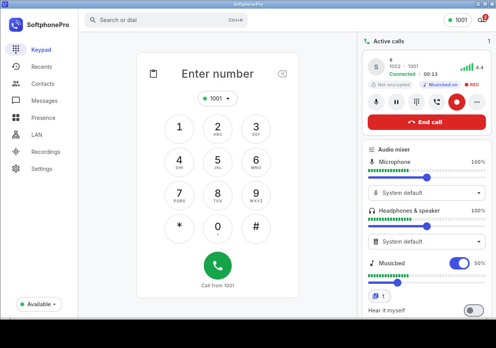

2. Settings, Audio: devices, musicbed switch, file, volume, monitor.

   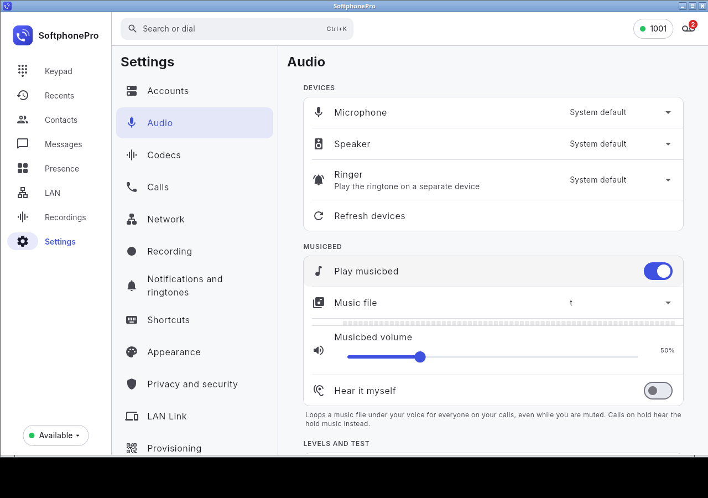

3. Phone-width window (400x820) in a call, strip collapsed.

   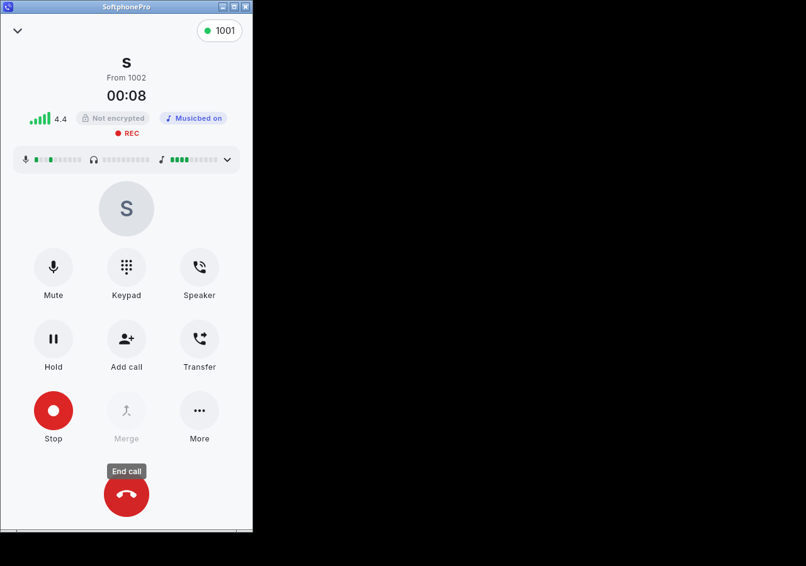

4. Arabic, desktop in a call: mirrored layout and navigation labels that now render as text.

   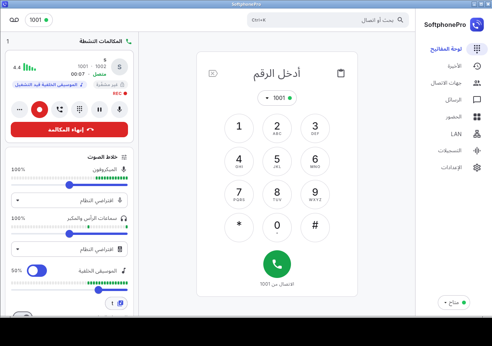

5. Language picker with the Arabic and Hindi entries drawn as text, not boxes.

   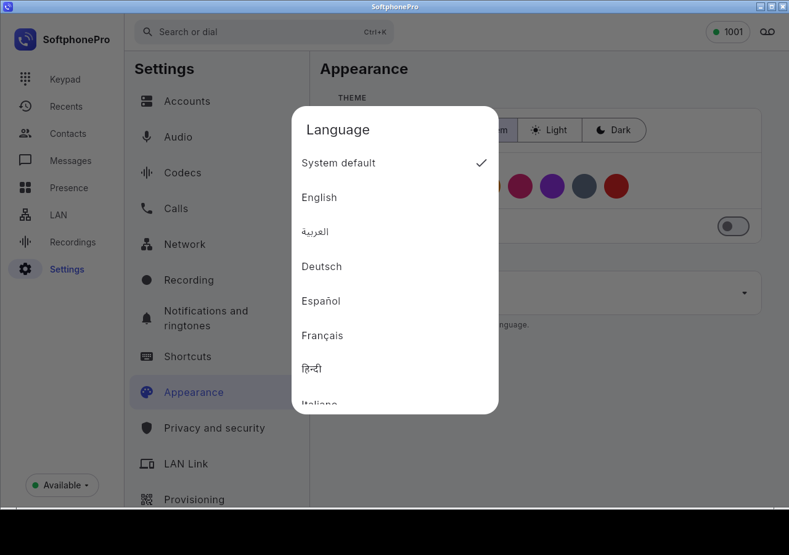

6. The real gnome-keyring unlock prompt on start (the app window waits behind it).

   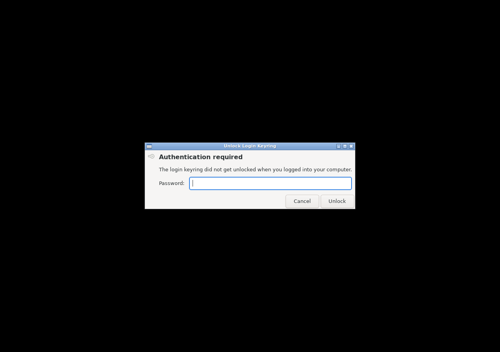

7. After dismissing the prompt: the app starts with the file store and shows the notice.

   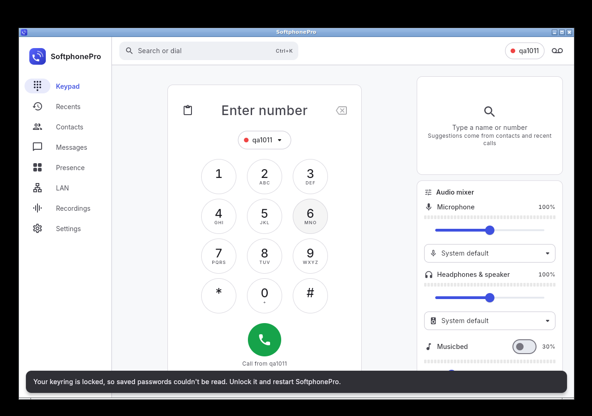

8. Missed-call notification "Show": the window comes back on Recents with the missed call.

   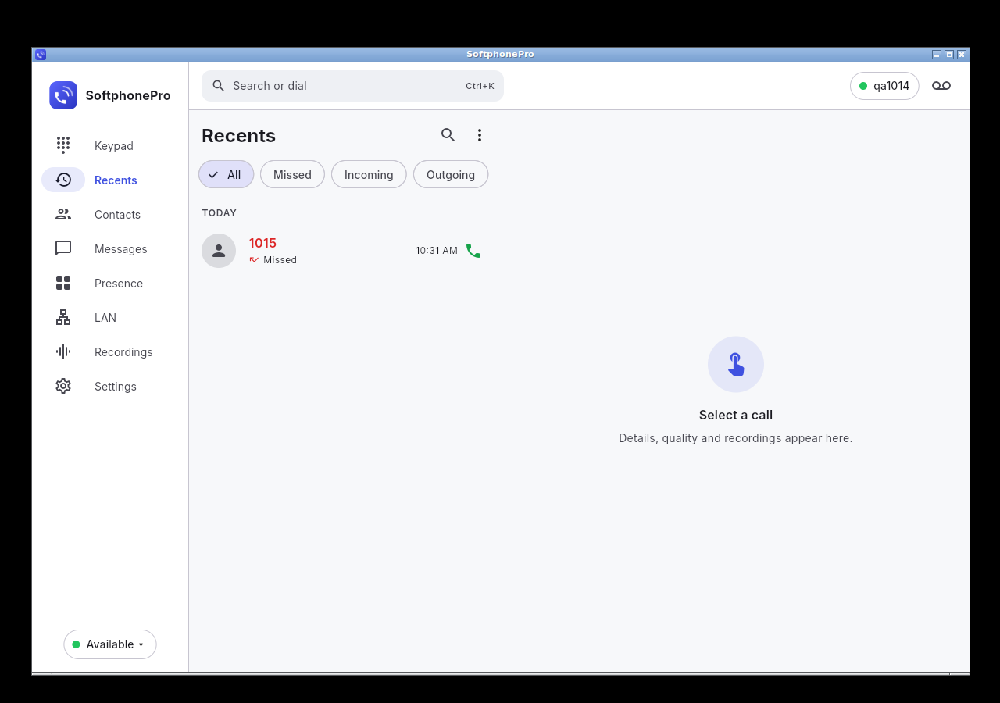

9. LAN Link pairing: the 6-digit code that must match on both devices.

   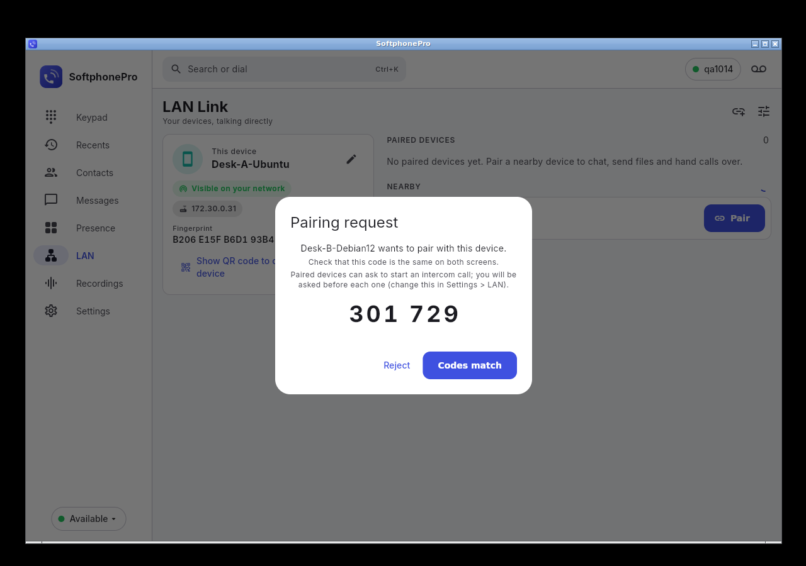

10. LAN Link: incoming file offer (1.0 MB) on the Debian device.

    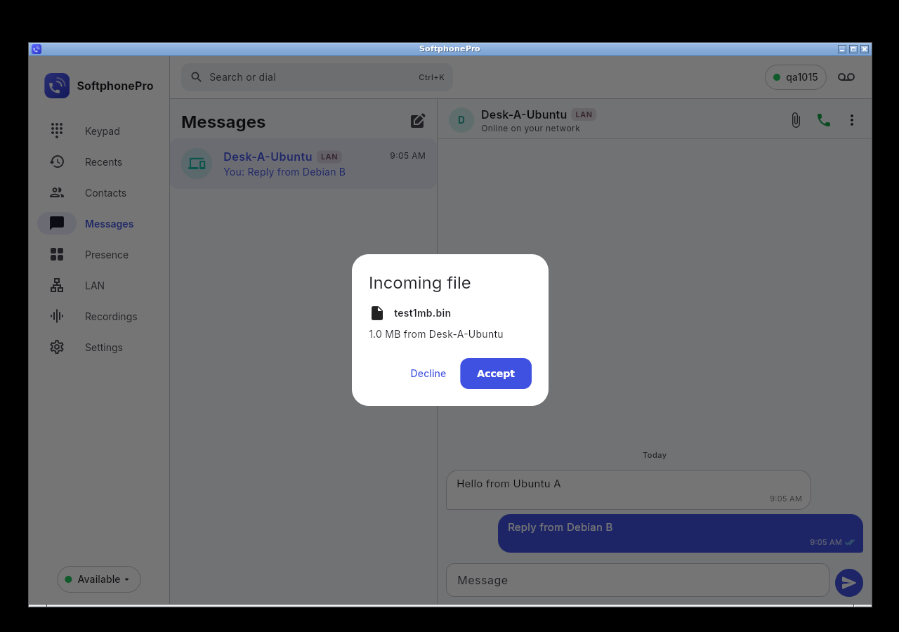

11. LAN Link chat between the Ubuntu and the Debian device (delivered ticks).

    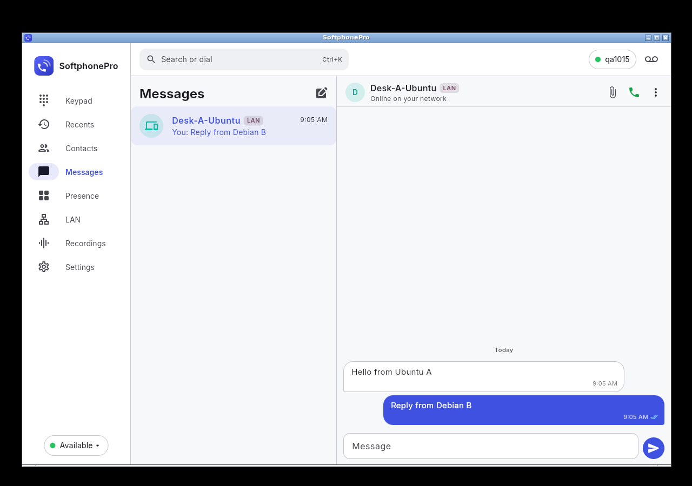

12. Call hand-off: the Ubuntu device shows "Relayed to Desk-B" with Take back and End, after Retry restored LAN calling.

    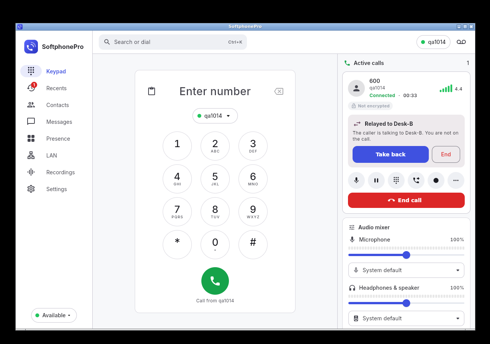

13. Debian 12 arm64: a `sip:600` link handed to the running app fills the dialer. The account dot is amber because this smoke run had no PBX behind it.

    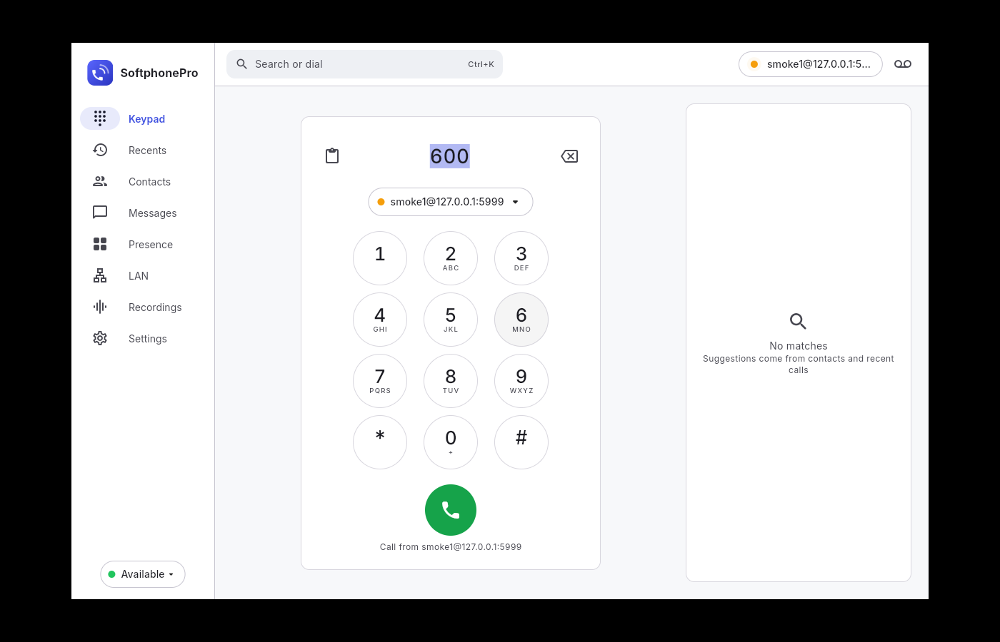

14. Recording from the Record button with no `~/Documents` folder (the old failure): the REC chip is on.

    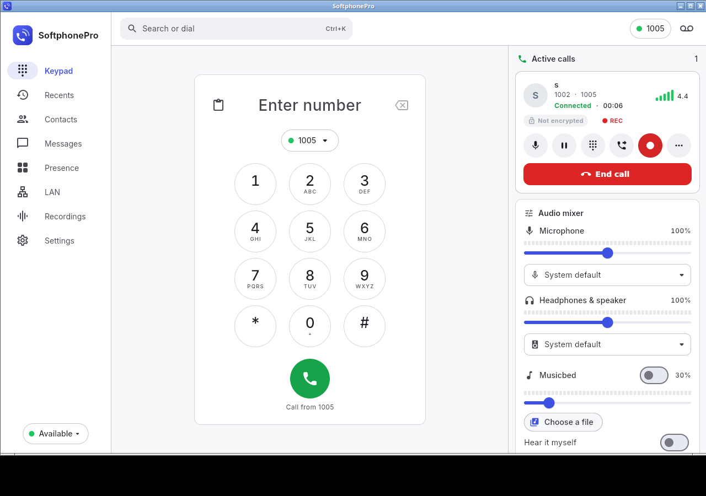

## Release check of 1.1.2 and fix check of 1.1.3

The `.deb` and `.tar.gz` files published for 1.1.2 were downloaded from the Releases page and tested in the same container setup (arm64, Xvfb, PulseAudio with a virtual microphone, Asterisk 20).

| Check | Result |
|---|---|
| Install and launch: arm64 on Debian 12, Debian 13, Ubuntu 22.04, Ubuntu 24.04; amd64 on Debian 12 and Ubuntu 24.04; the arm64 tarball as a normal user | PASS: no missing libraries, app and engine report 1.1.2 and run |
| Musicbed at the far end (15 checks) | PASS: bed at -9.3 dBFS while muted, volume 1.0 to 0.2 drops it 14.8 dB, nothing on hold, silence when off or paused |
| Live meters outside calls (new in 1.1.2) | PASS: the microphone meter moves on the idle keypad |
| Echo test (new in 1.1.2) | PASS: the speaker gets the microphone (1 kHz at -14.2 dBFS), it stops on request, by itself after 60 s, and when a call starts; call audio afterwards is normal |
| Test sound, chime, local playback (new in 1.1.2) | PASS |
| Microphone while idle | Held open while the window is visible (the live meters), released within 4 s when it is minimised or hidden to the tray |
| Tray, notification actions, MPRIS, `sip:`/`tel:` links, keyring unlock, start at login | PASS |
| LAN Link between Ubuntu 24.04 and Debian 12 | PASS after Retry (pairing, chat, 1 MB file with matching SHA-256), see the bug below |

**Bug found, fixed in 1.1.3:** turning on LAN Link while the app ran stopped the calling engine about 3 s later ("core already started"), every time, on both distributions (and already in 1.1.0). Two engine restarts ran at once. A 1.1.3 arm64 build was then checked: the LAN page button and a provisioning file each turned LAN Link on 3 times on Ubuntu 24.04 and 3 times on Debian 12, and LAN Link was switched off and on four times in a row with 0.3 s and 0.05 s gaps. Every time the engine restarted once and came back running in about 0.1 s, accounts re-registered, the LAN SIP listener came up, and pairing, chat and a call afterwards worked.

**Meters without a GPU:** on the idle keypad (1280x800, llvmpipe) with the microphone meter moving, 1.1.2 used 23.6 % of a core; 1.1.3 uses 2.3 % (meters still live: microphone level 92). Minimised: 0.4 %, microphone released.

**File choosers:** in 1.1.3 the LAN send-file chooser is titled "Send to device" (it was "Unnamed Window").

Full tables: the "v1.1.2 release check" sections of [RESULTS_audio.md](../tests/linux_e2e/RESULTS_audio.md) and [RESULTS_desktop.md](../tests/linux_e2e/RESULTS_desktop.md).

